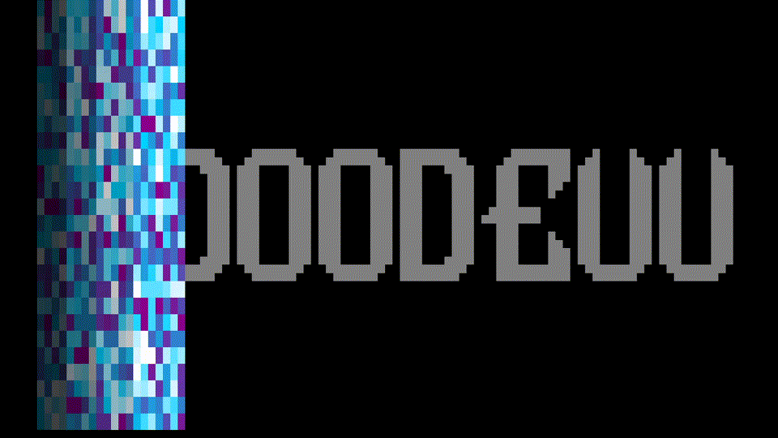
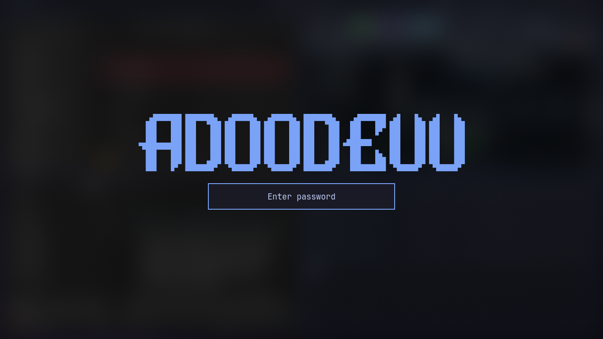

# hypr-nameplate

An Omarchy-style Hyprland desktop for Ubuntu, with **your name on it**: an animated
ASCII screensaver, a lock screen, a top bar and a themed terminal. It installs next
to GNOME instead of replacing it, so your normal desktop is always one logout away.


```bash
git clone https://github.com/adoodevv/hypr-nameplate.git
cd hypr-nameplate
bash install.sh --name yourname
```

> **Status:** built and used on one laptop (HP EliteBook, Intel graphics, Ubuntu 24.04).
> The installer is written to also work on Ubuntu 26.04, but that is untested.
> Expect rough edges and please open an issue when you find one.

## What you get

| | |
|---|---|
| **Screensaver** | Your name in block letters, cycling through random [terminaltexteffects](https://github.com/ChrisBuilds/terminaltexteffects) animations after 2.5 minutes idle. Works on GNOME and Hyprland. |
| **Lock screen** | Omarchy style: your current wallpaper, heavily blurred, with just a password box (hyprlock). Follows the wallpaper picker. |
| **Top bar** | Your name, workspaces, date and time, a music icon while something plays, Bluetooth, Wi-Fi, volume, brightness, battery and a power menu (Waybar). Clicking an icon opens a small panel under it: a calendar with the player (seek bar, previous / play / next) underneath while something plays, volume and brightness sliders with output selection, Wi-Fi networks, Bluetooth devices. Click anywhere outside to close it. |
| **Main menu** | <kbd>Super</kbd> + <kbd>Alt</kbd> + <kbd>Space</kbd> or click your name in the bar, like Omarchy's menu: apps, appearance, screenshots and recording, setup panels, config files, updates (apt, snap, firmware), about this computer, and power options. Type to search everything at once. |
| **Animations** | Omarchy's window open, close and fade timings on Hyprland. |
| **Terminal** | Alacritty in Tokyo Night with JetBrainsMono Nerd Font and a minimal Starship prompt. |
| **Launcher and notifications** | fuzzel and mako in matching colours. |
| **Screens** | <kbd>Super</kbd> + <kbd>P</kbd> extends, mirrors or switches to one screen when you plug in a projector or monitor. Unplugging it restores the laptop screen. |
| **Volume and brightness** | A small level indicator whenever you press the volume, mute or brightness keys. |
| **Low battery** | A warning at 15% and an urgent one at 5% while unplugged. |
| **Battery and power modes** | Click the battery for the charge, time left and power mode (power saver, balanced, performance). |
| **Clipboard history** | <kbd>Super</kbd> + <kbd>Ctrl</kbd> + <kbd>V</kbd>: search what you copied recently, text and images; click to copy it again. |
| **Emoji picker** | <kbd>Super</kbd> + <kbd>Ctrl</kbd> + <kbd>E</kbd>: search by name or everyday words ("laugh", "thanks"); recent ones first. |
| **Screen recording** | <kbd>Alt</kbd> + <kbd>Print</kbd> for a region, add <kbd>Shift</kbd> for the whole screen or <kbd>Ctrl</kbd> for the whole screen with your microphone. Same keys or the red dot in the bar stop it. Saved as .mp4 in `~/Videos/Screencasts`. |
| **Notifications** | <kbd>Super</kbd> + <kbd>,</kbd> dismisses, add <kbd>Shift</kbd> for all, <kbd>Alt</kbd> to bring the last one back, <kbd>Ctrl</kbd> for do not disturb. |
| **Top bar extras** | Like Omarchy's bar: **stay awake** (a cup; no screensaver or lock), **night light** (warmer colours, via hyprsunset) and **do not disturb** sit before the clock: dim when off, lit when on, click to switch. The recording dot joins them while you record. After the clock: **weather** (from wttr.in; click for the next hours and days, or set your city) and **updates**, which appears only when Ubuntu has some waiting. On the right, an **AI agents** robot when Claude Code, Grok, Muse or opencode is installed: click it for today's tokens and prompts, the week at a glance, the model you use most, and your recent sessions (click one to pick it back up). It reads only the history they keep on your computer. Then the **microphone** (click to mute). The bar item whose panel is open gets an accent line under it. |
| **Themes** | <kbd>Super</kbd> + <kbd>Ctrl</kbd> + <kbd>Shift</kbd> + <kbd>Space</kbd> (or Menu → Appearance → Theme): Omarchy's 23 colour themes, including Tokyo Night, Catppuccin, Gruvbox, Nord, Rosé Pine, Everforest, Kanagawa and a few light ones. The bar, panels, terminal, notifications, launcher, window borders and lock screen all switch at once, and so does the wallpaper if you downloaded Omarchy's collection. GNOME is not touched (except the terminal, which both share). |
| **Fonts** | Menu → Appearance → Font: switch the terminal, bar, panels, launcher and notifications to any installed Nerd Font, set the terminal size (9 by default, like Omarchy), or download a few popular ones (Caskaydia Mono, Fira Code, Hack, Geist Mono, Source Code Pro, Ubuntu Mono). Like Omarchy, it also becomes your account's monospace font, so code in GNOME apps and anything asking for "monospace" follows it, on GNOME too (the uninstaller puts the old one back). |
| **Wallpapers** | Double-click the desktop for a picker; <kbd>Super</kbd> + <kbd>Ctrl</kbd> + <kbd>Space</kbd> for the next one. Drop your own images in `~/Pictures/Wallpapers`. The installer can also download Omarchy's artwork (74 images) straight from Omarchy's repository, leaving out the ones that only show its name or logo. |



| Lock screen | Launcher |
|---|---|
|  |  |

| Terminal | Top bar |
|---|---|
|  |  |

## Before you install

- **Ubuntu 24.04 or 26.04**, on the standard GNOME desktop with the GDM login screen.
- **Take a Timeshift snapshot first** (`sudo apt install timeshift`). Hyprland comes from the
  community PPA [`ppa:cppiber/hyprland`](https://launchpad.net/~cppiber/+archive/ubuntu/hyprland),
  because Ubuntu's own Hyprland package is too old for this config. On 24.04 that PPA also
  ships a newer `libinput`, which GNOME uses too. That is the only part that touches your
  existing desktop, and a snapshot is what makes it fully reversible.
- **Turn off automatic login**, or you will never see the screen where you choose between
  Hyprland and GNOME.
- NVIDIA graphics are untested.

The installer checks these with you. It also shows which installed packages would change,
refuses to continue if apt would remove anything, and backs up any config file of yours it
replaces as `name.bak-DATE`. Re-running it only makes a backup when you edited a file since
the last install; theme and font changes don't count.

## Install options

```
bash install.sh [options]

  --name NAME       Name shown on the screensaver and bar
                    (default: your username). Up to about 12 characters
                    gets the large block lettering; longer names fall back
                    to smaller lettering.
  --terminal-only   Only the terminal, prompt and screensaver, on your current
                    GNOME desktop. Skips Hyprland and the PPA entirely.
  --configs-only    Don't install any packages; just (re)write the configs.
  --theme THEME     Colour theme, e.g. gruvbox, nord, catppuccin, rose-pine
                    (default: keep the current one, Tokyo Night at first).
```

`--terminal-only` is the low-risk way to try it: no PPA, nothing outside your home folder
except a few packages from Ubuntu's own repositories.

To change the name later:

```bash
bash install.sh --configs-only --name newname
```

## Starting Hyprland

1. Log out.
2. On the login screen click your name, then the gear icon at the bottom right.
3. Choose **Hyprland**, then log in.
4. Press <kbd>Super</kbd> + <kbd>K</kbd> for the cheat sheet.

To go back to GNOME, press <kbd>Super</kbd> + <kbd>Escape</kbd>, choose Log out, and pick
**Ubuntu** from the same gear icon.

If the screen comes up blank or broken: <kbd>Ctrl</kbd> + <kbd>Alt</kbd> + <kbd>F3</kbd>,
log in on the text console, run `pkill Hyprland`, and choose Ubuntu at the login screen.

## Keys

<kbd>Super</kbd> is the Windows key.

| Keys | Action |
|---|---|
| Super + Return | Terminal |
| Super + Alt + Space | Main menu (or click your name in the bar) |
| Super + Space | App launcher |
| Super + E | Files |
| Super + K | Cheat sheet |
| Super + Escape | Power options |
| Super + L | Lock |
| Super + Ctrl + S | Start the screensaver now |
| Super + Ctrl + Shift + Space | Colour theme |
| Super + Ctrl + I | Stay awake (no screensaver or lock) |
| Super + Ctrl + L | Night light |
| Super + Ctrl + M | Mute the microphone |
| Super + Ctrl + Space | Next wallpaper |
| Super + P | Screens: extend, mirror, one screen |
| Super + Ctrl + A / B / N / P | Sound, Bluetooth, network, power panels |
| Super + Ctrl + V | Clipboard history |
| Super + Ctrl + E | Emoji picker |
| Alt + Print | Record the screen (again to stop) |
| Super + , | Dismiss notification (Ctrl: do not disturb) |
| Super + W | Close window |
| Super + arrows | Move focus |
| Super + Shift + arrows | Swap windows |
| Super + F / Super + Alt + F | Fullscreen / maximise |
| Super + T | Float or tile a window |
| Super + J | Flip the split |
| Super + Alt + P | Pseudo-tile (keep a window's own size in its tile) |
| Super + 1..0 | Go to workspace |
| Super + Shift + 1..0 | Send window to workspace |
| Super + S | Scratchpad |
| Super + Shift + S (or Print) | Screenshot a region |
| Super + Shift + P (or Shift + Print) | Screenshot the whole screen |

## Where things live

| Path | What |
|---|---|
| `~/.config/hypr/hyprland.lua` | Keys, animations, window rules. Reloads on save. |
| `~/.config/hypr/hyprlock.conf` | Lock screen |
| `~/.config/hypr/hypridle.conf` | Idle timings (screensaver, lock, screen off, suspend) |
| `~/.config/waybar/` | Top bar layout and CSS |
| `~/.config/fuzzel/fuzzel.ini` | Launcher |
| `~/.config/mako/config` | Notifications |
| `~/.config/xdg-desktop-portal/hyprland-portals.conf` | Lets sandboxed apps (snaps such as Proton VPN) use the GNOME keyring under Hyprland |
| `~/.config/alacritty/alacritty.toml` | Terminal |
| `~/.config/starship.toml` | Prompt |
| `~/.config/nameplate/` | Your name's artwork, wallpaper, themes, helper scripts |

Each themed file has a block between `theme:begin` and `theme:end` lines holding its colours.
Switching theme rewrites only that block, so your other edits to those files stay. To make
your own theme, copy a file from `~/.config/nameplate/themes/` into
`~/.config/nameplate/user-themes/`, rename it, change the colours, and it shows up in the picker.

Hyprland 0.57 removed the old `hyprland.conf` format, so this project uses the Lua config.
Most Hyprland tutorials written before mid-2026 show the old syntax.

## Uninstall

```bash
bash uninstall.sh
```

This removes the configs this project installed and puts back the ones you had before.
Other files in those folders and the installer's `.bak-DATE` backups are kept (it prints
the command to delete the backups). It also prints the commands for removing the packages
and restoring Ubuntu's own library versions with `ppa-purge`.

## Testing

```bash
bash tests/smoke.sh
```

Checks that every script parses and every theme loads, then installs, reinstalls and
uninstalls into a throwaway home folder. It installs no packages, and anything that would
reach your running session (`pkill`, `hyprctl`, `gsettings`, ...) is stubbed out.

## Known limits

- Tested on a single machine.
- The PPA updates Hyprland with every `apt upgrade`, and Hyprland changes its config API often.
  An update can break the Hyprland session until the config is adjusted. GNOME is unaffected.
- A release upgrade (for example 24.04 to 26.04) disables third-party PPAs. Run the installer
  again afterwards.
- If Spotify is installed, its launcher entry is copied to `~/.local/share/applications` and set to run natively on
  Wayland, because under Hyprland it otherwise cuts off its player bar. Re-run the installer if a Spotify update resets it.
- Dialogs from apps such as RViz or Gazebo get tiled like normal windows; float them with Super + T.
- The GNOME screensaver is a small script polling the idle time, not a real screensaver API.
  It does not lock the screen; GNOME's own lock still does that.

## Taking the screenshots

For maintainers: the images above live in `docs/screenshots/`.

```bash
# anything on the desktop: region, or the whole screen
Super + Shift + S   /   Super + Shift + P     # saved to ~/Pictures/Screenshots

# things that close when you press a key (launcher, screensaver): use a delay
sleep 5 && ~/.config/nameplate/bin/screenshot full

# the screensaver as a GIF (sudo apt install wf-recorder ffmpeg)
~/.config/nameplate/bin/launch-screensaver & sleep 1
wf-recorder -f /tmp/saver.mp4 & sleep 12; pkill -INT wf-recorder
ffmpeg -i /tmp/saver.mp4 -vf "fps=15,scale=960:-1" docs/screenshots/screensaver.gif
```

## Credits

- [Omarchy](https://omarchy.org) by DHH and contributors, including the optional wallpaper collection
  (downloaded from Omarchy's repository by `get-omarchy-wallpapers`, not included here), for the look, the animation timings
  and the idea of a terminal screensaver. The animation curve and timing values are taken
  from Omarchy's MIT-licensed config. This project is not affiliated with Omarchy; it is a
  small independent setup for people who need to stay on Ubuntu.
- [Hyprland](https://hypr.land), hyprlock and hypridle by the hyprwm team.
- [cpiber/hyprland-ppa](https://github.com/cpiber/hyprland-ppa) for the Ubuntu packages.
- [terminaltexteffects](https://github.com/ChrisBuilds/terminaltexteffects) by ChrisBuilds.
- The colour themes in `share/themes` are Omarchy's palettes (MIT, from `themes/*/colors.toml`),
  which in turn adapt Tokyo Night, Catppuccin, Gruvbox, Nord, Rosé Pine, Everforest, Kanagawa and
  others by their original authors.
- Waybar, fuzzel, mako, Alacritty, Starship, pyfiglet and the Nerd Fonts project.

If you want the complete Omarchy experience on Ubuntu rather than a small look-alike, see
[hvpaiva/omarchy-ubuntu](https://github.com/hvpaiva/omarchy-ubuntu).

## License

MIT. See [LICENSE](LICENSE).
