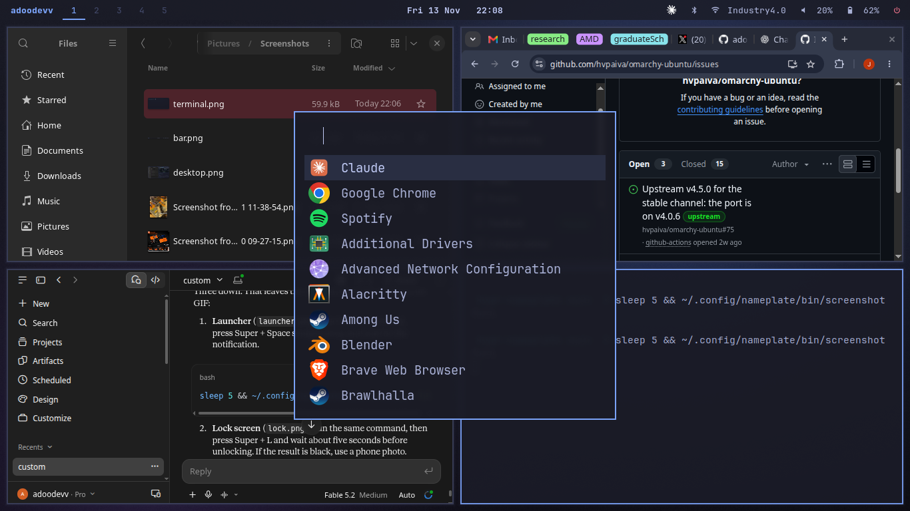
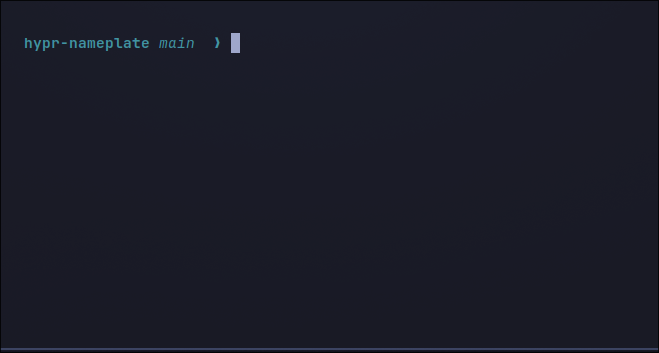

# hypr-nameplate

An Omarchy-style Hyprland desktop for Ubuntu, with **your name on it**: an animated
ASCII screensaver, a lock screen, a top bar and a themed terminal. It installs next
to GNOME instead of replacing it, so your normal desktop is always one logout away.


```bash
git clone https://github.com/adoodevv/hypr-nameplate.git
cd hypr-nameplate
bash install.sh --name yourname
```

> **Status:** built and used on one laptop (HP EliteBook, Intel graphics, Ubuntu 24.04).
> The installer is written to also work on Ubuntu 26.04, but that is untested.
> Expect rough edges and please open an issue when you find one.

## What you get

| | |
|---|---|
| **Screensaver** | Your name in block letters, cycling through random [terminaltexteffects](https://github.com/ChrisBuilds/terminaltexteffects) animations after 2.5 minutes idle. Works on GNOME and Hyprland. |
| **Lock screen** | Your screen blurred behind your name and a password box (hyprlock). |
| **Top bar** | Your name, workspaces, date and time, Bluetooth, Wi-Fi, volume, battery and a power menu (Waybar). |
| **Animations** | Omarchy's window open, close and fade timings on Hyprland. |
| **Terminal** | Alacritty in Tokyo Night with JetBrainsMono Nerd Font and a minimal Starship prompt. |
| **Launcher and notifications** | fuzzel and mako in matching colours. |


| Lock screen | Launcher |
|---|---|
|  |  |

| Terminal | Top bar |
|---|---|
|  |  |

## Before you install

- **Ubuntu 24.04 or 26.04**, on the standard GNOME desktop with the GDM login screen.
- **Take a Timeshift snapshot first** (`sudo apt install timeshift`). Hyprland comes from the
  community PPA [`ppa:cppiber/hyprland`](https://launchpad.net/~cppiber/+archive/ubuntu/hyprland),
  because Ubuntu's own Hyprland package is too old for this config. On 24.04 that PPA also
  ships a newer `libinput`, which GNOME uses too. That is the only part that touches your
  existing desktop, and a snapshot is what makes it fully reversible.
- **Turn off automatic login**, or you will never see the screen where you choose between
  Hyprland and GNOME.
- NVIDIA graphics are untested.

The installer checks these with you. It also shows which installed packages would change,
refuses to continue if apt would remove anything, and backs up every config file it replaces
as `name.bak-DATE`.

## Install options

```
bash install.sh [options]

  --name NAME       Name shown on the screensaver, lock screen and bar
                    (default: your username). Up to about 12 characters
                    gets the large block lettering; longer names fall back
                    to smaller lettering.
  --terminal-only   Only the terminal, prompt and screensaver, on your current
                    GNOME desktop. Skips Hyprland and the PPA entirely.
  --configs-only    Don't install any packages; just (re)write the configs.
```

`--terminal-only` is the low-risk way to try it: no PPA, nothing outside your home folder
except a few packages from Ubuntu's own repositories.

To change the name later:

```bash
bash install.sh --configs-only --name newname
```

## Starting Hyprland

1. Log out.
2. On the login screen click your name, then the gear icon at the bottom right.
3. Choose **Hyprland**, then log in.
4. Press <kbd>Super</kbd> + <kbd>K</kbd> for the cheat sheet.

To go back to GNOME, press <kbd>Super</kbd> + <kbd>Escape</kbd>, choose Log out, and pick
**Ubuntu** from the same gear icon.

If the screen comes up blank or broken: <kbd>Ctrl</kbd> + <kbd>Alt</kbd> + <kbd>F3</kbd>,
log in on the text console, run `pkill Hyprland`, and choose Ubuntu at the login screen.

## Keys

<kbd>Super</kbd> is the Windows key.

| Keys | Action |
|---|---|
| Super + Return | Terminal |
| Super + Space | App launcher |
| Super + E | Files |
| Super + K | Cheat sheet |
| Super + Escape | Power menu |
| Super + L | Lock |
| Super + Ctrl + S | Start the screensaver now |
| Super + W | Close window |
| Super + arrows | Move focus |
| Super + Shift + arrows | Swap windows |
| Super + F / Super + Alt + F | Fullscreen / maximise |
| Super + T | Float or tile a window |
| Super + J | Flip the split |
| Super + 1..0 | Go to workspace |
| Super + Shift + 1..0 | Send window to workspace |
| Super + S | Scratchpad |
| Super + Shift + S (or Print) | Screenshot a region |
| Super + Shift + P (or Shift + Print) | Screenshot the whole screen |

## Where things live

| Path | What |
|---|---|
| `~/.config/hypr/hyprland.lua` | Keys, animations, window rules. Reloads on save. |
| `~/.config/hypr/hyprlock.conf` | Lock screen |
| `~/.config/hypr/hypridle.conf` | Idle timings (screensaver, lock, screen off, suspend) |
| `~/.config/waybar/` | Top bar layout and CSS |
| `~/.config/fuzzel/fuzzel.ini` | Launcher |
| `~/.config/mako/config` | Notifications |
| `~/.config/xdg-desktop-portal/hyprland-portals.conf` | Lets sandboxed apps (snaps such as Proton VPN) use the GNOME keyring under Hyprland |
| `~/.config/alacritty/alacritty.toml` | Terminal |
| `~/.config/starship.toml` | Prompt |
| `~/.config/nameplate/` | Your name's artwork, wallpaper, helper scripts |

Hyprland 0.57 removed the old `hyprland.conf` format, so this project uses the Lua config.
Most Hyprland tutorials written before mid-2026 show the old syntax.

## Uninstall

```bash
bash uninstall.sh
```

This removes the configs and prints the commands for removing the packages and restoring
Ubuntu's own library versions with `ppa-purge`.

## Known limits

- Tested on a single machine.
- The PPA updates Hyprland with every `apt upgrade`, and Hyprland changes its config API often.
  An update can break the Hyprland session until the config is adjusted. GNOME is unaffected.
- A release upgrade (for example 24.04 to 26.04) disables third-party PPAs. Run the installer
  again afterwards.
- If Spotify is installed, its launcher entry is copied to `~/.local/share/applications` and set to run natively on
  Wayland, because under Hyprland it otherwise cuts off its player bar. Re-run the installer if a Spotify update resets it.
- Dialogs from apps such as RViz or Gazebo get tiled like normal windows; float them with Super + T.
- The GNOME screensaver is a small script polling the idle time, not a real screensaver API.
  It does not lock the screen; GNOME's own lock still does that.

## Taking the screenshots

For maintainers: the images above live in `docs/screenshots/`.

```bash
# anything on the desktop: region, or the whole screen
Super + Shift + S   /   Super + Shift + P     # saved to ~/Pictures/Screenshots

# things that close when you press a key (launcher, screensaver): use a delay
sleep 5 && ~/.config/nameplate/bin/screenshot full

# the screensaver as a GIF (sudo apt install wf-recorder ffmpeg)
~/.config/nameplate/bin/launch-screensaver & sleep 1
wf-recorder -f /tmp/saver.mp4 & sleep 12; pkill -INT wf-recorder
ffmpeg -i /tmp/saver.mp4 -vf "fps=15,scale=960:-1" docs/screenshots/screensaver.gif
```

## Credits

- [Omarchy](https://omarchy.org) by DHH and contributors, for the look, the animation timings
  and the idea of a terminal screensaver. The animation curve and timing values are taken
  from Omarchy's MIT-licensed config. This project is not affiliated with Omarchy; it is a
  small independent setup for people who need to stay on Ubuntu.
- [Hyprland](https://hypr.land), hyprlock and hypridle by the hyprwm team.
- [cpiber/hyprland-ppa](https://github.com/cpiber/hyprland-ppa) for the Ubuntu packages.
- [terminaltexteffects](https://github.com/ChrisBuilds/terminaltexteffects) by ChrisBuilds.
- [Tokyo Night](https://github.com/enkia/tokyo-night-vscode-theme) colour scheme by enkia.
- Waybar, fuzzel, mako, Alacritty, Starship, pyfiglet and the Nerd Fonts project.

If you want the complete Omarchy experience on Ubuntu rather than a small look-alike, see
[hvpaiva/omarchy-ubuntu](https://github.com/hvpaiva/omarchy-ubuntu).

## License

MIT. See [LICENSE](LICENSE).
