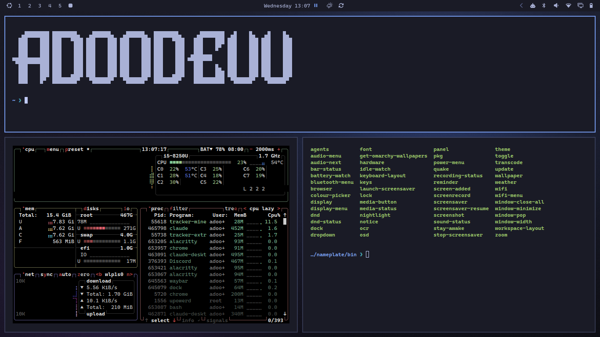
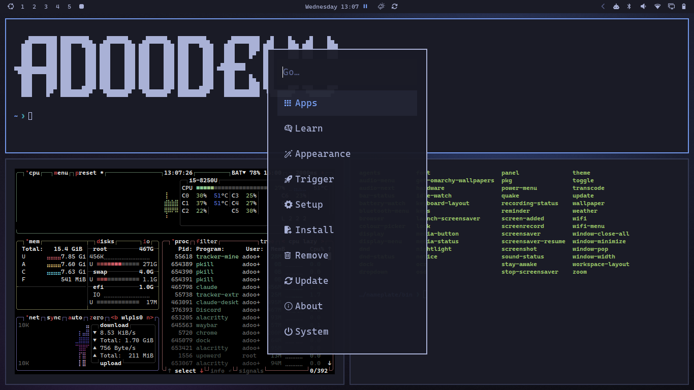

# hypr-nameplate

An Omarchy-style Hyprland desktop for Ubuntu, with **your name on it**. It installs next
to GNOME, so your normal desktop is always one logout away.



## Install

```bash
git clone https://github.com/adoodevv/hypr-nameplate.git
cd hypr-nameplate
bash install.sh --name yourname
```

Then log out, click the gear icon on the login screen, pick **Hyprland** and log in.
Press <kbd>Super</kbd> + <kbd>K</kbd> for the cheat sheet.

**Before you run it:**

- Ubuntu 24.04 (26.04 should work but is untested) on the standard GNOME desktop.
- Take a [Timeshift](https://github.com/linuxmint/timeshift) snapshot. Hyprland comes from the
  [`cppiber/hyprland`](https://launchpad.net/~cppiber/+archive/ubuntu/hyprland) PPA, which on 24.04
  also updates `libinput`, which GNOME shares.
- Turn off automatic login, or you never get to choose Hyprland.

The installer asks before changing anything, won't continue if apt would remove a package, and
backs up any config of yours that it replaces (`name.bak-DATE`).

**Just want to try it?** `bash install.sh --terminal-only` adds only the terminal, prompt and
screensaver to GNOME. It doesn't use the PPA or install Hyprland.

| Option | |
|---|---|
| `--name NAME` | Name on the screensaver and bar (kept on later runs) |
| `--theme THEME` | Starting theme, e.g. `gruvbox`, `nord`, `rose-pine` |
| `--terminal-only` | Terminal, prompt and screensaver only, on GNOME |
| `--configs-only` | Rewrite the configs without installing packages |

## What you get

- **Screensaver:** your name in block letters, animated with
  [terminaltexteffects](https://github.com/ChrisBuilds/terminaltexteffects), after 2.5 idle minutes (GNOME and Hyprland).
- **Lock screen:** like Omarchy's, a password field on your blurred wallpaper.
- **Top bar:** workspaces, clock, weather, updates, toggles (night light, do not disturb, stay awake),
  a tray behind a chevron, AI agent stats, Bluetooth, Wi-Fi, sound, display and battery. Each icon opens a small panel.
- **Main menu** (<kbd>Super</kbd> + <kbd>Space</kbd>) laid out like Omarchy's: apps, appearance (theme, font, gaps, dock,
  animations, lock-screen blur), setup, a hardware menu, install and remove (apt, snaps, Flathub), updates with a
  Timeshift snapshot first, and power.
- **23 Omarchy themes** (<kbd>Super</kbd> + <kbd>Ctrl</kbd> + <kbd>Shift</kbd> + <kbd>Space</kbd>). They recolour everything at once,
  wallpaper included if you download Omarchy's collection.
- **Workspace layouts:** tiling, scrolling or floating (<kbd>Super</kbd> + <kbd>L</kbd>). Floating workspaces get a dock.
- Omarchy 4.5's keys and tools: a drop-down terminal, universal copy/paste, a colour picker, text from
  screen (OCR), reminders, video and picture conversion, a world clock, notification history, zoom,
  and transparency, gaps and laptop-screen toggles.
- Clipboard history, an emoji picker, screenshots, screen recording, a screen switcher for projectors,
  volume and brightness popups, and low-battery warnings.

| Main menu | Screensaver |
|---|---|
|  |  |

## Keys

<kbd>Super</kbd> is the Windows key. <kbd>Super</kbd> + <kbd>K</kbd> lists them all.

| Keys | Action |
|---|---|
| Super + Return | Terminal |
| Super + Space | Main menu |
| Super + Alt + Space | App launcher |
| Super + W | Close window |
| Super + 1..0 | Go to workspace (add Shift to send the window there) |
| Super + F | Fullscreen |
| Super + T | Float or tile a window |
| Super + L | Workspace layout: tiling, scrolling, floating |
| Super + Ctrl + L | Lock |
| Super + Escape | Power options |
| Super + Ctrl + Space | Wallpaper |
| Super + Ctrl + V / E | Clipboard history / emoji |
| Super + Shift + S | Screenshot a region |
| Super + Ctrl + C | Capture menu: screenshot, recording, colour picker, text from screen |
| Alt + Print | Record the screen (again to stop) |
| Super + C / X / V | Copy / cut / paste in every app, terminals too |
| Super + ` | Drop-down terminal |
| Super + Ctrl + O | Toggles: do not disturb, night light, gaps, laptop screen… |
| Super + Ctrl + R | Set a reminder ("20m stretch") |
| Super + Ctrl + H | Hardware: touchpad, keyboard light, graphics |

## Customising

Configs are in `~/.config` (`hypr/`, `waybar/`, `alacritty/`, `fuzzel/`, `mako/`), and the
helpers, themes and artwork are in `~/.config/nameplate/`. Only the lines between `theme:begin` and
`theme:end` get rewritten when you switch theme, so your other edits stay. To make your own
theme, copy one from `~/.config/nameplate/themes/` into `~/.config/nameplate/user-themes/`.

To change the name later, run `bash install.sh --configs-only --name newname`.

## Help

- **Blank screen in Hyprland:** press <kbd>Ctrl</kbd> + <kbd>Alt</kbd> + <kbd>F3</kbd>, log in, run `pkill Hyprland`, and pick Ubuntu at the login screen.
- **After an `apt upgrade`:** Hyprland changes its config often, so an update can break the session until the config catches up. GNOME isn't affected.
- **After a release upgrade:** Ubuntu turns PPAs off, so run the installer again.
- Tested on a single laptop (HP EliteBook, Intel graphics, Ubuntu 24.04). NVIDIA is untested. Please open an issue when something breaks.

## Uninstall

```bash
bash uninstall.sh
```

This removes the project's configs, puts back the ones you had before, and keeps the `.bak-DATE`
backups. It prints the commands for removing the packages and the PPA.

Developers can run `bash tests/smoke.sh`. It installs, reinstalls and uninstalls into a throwaway home folder.

**The Rust part.** `rust/` is a Cargo workspace with three programs:

- `nameplate` (`rust/core`, no dependencies): the bar's items, the volume and brightness keys,
  the window and layout keys (minimize, pop out, close all, width, layout cycle, keyboard
  layout, browser), and the low-battery watcher. Each bar item waits for something to change (PipeWire, the
  kernel's network and power files, Hyprland's event socket) instead of the bar starting a
  script every few seconds. Scripts that toggle something call `nameplate refresh ITEM`.
- `nameplate-shell` (`rust/shell`, GTK 3 and gtk-layer-shell): the wallpaper and the dock,
  with their commands (`nameplate-shell wallpaper set|next|list|lock`,
  `nameplate-shell dock pinned|pin|unpin|autohide`).
- `nameplate-agents` (`rust/agents`, serde and a bundled SQLite): the agents panel's usage
  stats from Claude Code, Grok, Muse and OpenCode history.

The installer installs what building them needs (`cargo pkg-config libgtk-3-dev
libgtk-layer-shell-dev`) and builds them into `~/.config/nameplate/bin`; the desktop needs them.
`Cargo.lock` is resolved for Ubuntu 24.04's Rust 1.75, so keep building with `--locked`. Run the tests with `cargo test --manifest-path rust/Cargo.toml`.

## Credits

[Omarchy](https://omarchy.org) (MIT) for the look, the animation timings, the theme palettes and the
optional wallpapers, which are downloaded from its repository and not included here. This project isn't
affiliated with Omarchy. Also [Hyprland](https://hypr.land), [cpiber/hyprland-ppa](https://github.com/cpiber/hyprland-ppa),
[terminaltexteffects](https://github.com/ChrisBuilds/terminaltexteffects), Waybar, fuzzel, mako, Alacritty,
Starship and Nerd Fonts. For the full Omarchy on Ubuntu, see [hvpaiva/omarchy-ubuntu](https://github.com/hvpaiva/omarchy-ubuntu).

## License

MIT. See [LICENSE](LICENSE).
